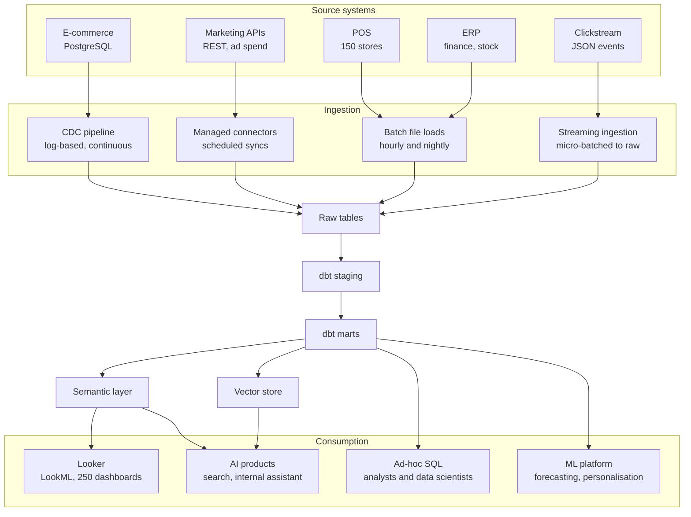

# Data Engineering Manager — Case Study

## About this case study

This case study describes the data platform of a fictional retail group.

There is no single correct answer. We are most interested in your reasoning: what you would prioritise, what you would deliberately leave for later, and how you would bring the team and the business with you.

Please limit your preparation to around 3 hours and do not write any code. One architecture diagram, a structured plan and clearly explained trade-offs are sufficient.

## About the retail group

The group is a large retailer selling fashion, home and electronics through around 150 stores, a website and a mobile app. Online channels account for roughly a third of revenue, and the group's largest seasonal sale begins in four months.

AI is already part of the business. The ML team runs demand forecasting and personalisation in production, natural-language product search is live on the website and app, and an internal assistant answers questions from store and category managers about sales, stock and promotions. Use of all three is growing quickly, and the business keeps asking for more.

You would lead the data function, which brings together four teams:

| Team | Size | Responsibilities |
| --- | --- | --- |
| Data Engineering | 4 engineers, 2 of them senior | Ingestion, orchestration, dbt transformations and the warehouse |
| Data Analytics | 4 analysts | Looker dashboards, LookML models and analysis for business teams |
| Data Quality | 1 engineer | Data testing, monitoring and reconciliation |
| Machine Learning | 3 engineers | Forecasting and personalisation models, and the AI products |

The Platform and DevOps team supports the data function. It owns the shared cloud infrastructure, networking and the Kubernetes cluster that hosts Airflow, all managed through Terraform. Your main business stakeholders are Finance, Commercial, Supply Chain and Marketing, who depend on the daily trading reports and month-end figures.

## Current platform

The platform runs on a single public cloud and is in reasonable health. Five source systems reach a cloud data warehouse through four ingestion routes. Transformations run in dbt with tests and CI, certified metrics are defined in a semantic layer, and the warehouse is consumed through Looker, ad-hoc SQL, the ML team's models and the AI products.

Everything in the diagram is version-controlled, deployed through CI and monitored. Airflow on Kubernetes orchestrates the scheduled routes and the dbt build, while the CDC and streaming routes run continuously with their own alerting. Failures page an on-call engineer, and the most important DAGs have runbooks. Batch loads land files in object storage first and are idempotent, so resent files do not create duplicates.

A semantic layer defines the certified trading metrics, and a data catalog records ownership and lineage across the warehouse. The AI products run on the same foundations: product embeddings are rebuilt nightly from the marts into a vector store that serves search, and the assistant answers by retrieving from that store and reading certified metrics from the semantic layer.

The gaps are operational rather than structural. Answer quality is judged by spot checks rather than measured, the assistant runs under a single service account instead of the permissions of the person asking, feature logic is duplicated across dbt models rather than shared through a feature store, and nobody can say what the AI products cost to run.

Key technical details:

- **E-commerce:** log-based change data capture into raw tables. Schema changes are detected automatically and breaking changes are caught in CI, although the e-commerce team is under no formal contract to announce them.
- **POS:** each store sends hourly batches. Loads are idempotent and deduplicated, but stores restate corrected figures for up to three days, so published daily numbers move after the fact.
- **ERP:** a nightly incremental extract covering finance, inventory and purchasing. ERP posts in store local time and staging converts to UTC, but month-end adjustments arrive two days late, so the daily marts and the month-end close disagree until they land.
- **Clickstream:** about 40 million JSON events a day, ingested continuously against a schema registry, with late and duplicate events resolved in staging.
- **Transformation:** a dbt project of around 900 models with separate development and production environments. Every pull request is compiled and tested in CI. About 30% of models are incremental; the rest are rebuilt in full by a single daily run.
- **Semantic layer:** certified metrics are defined once and served to Looker. Ad-hoc SQL and the ML feature models still read the marts directly, so a definition changed in the semantic layer does not change their results.
- **AI products:** search and the assistant are served from the same marts. Embeddings are refreshed nightly, so new lines and price changes are up to a day stale, which matters most during the sale. There is no offline evaluation set, so regressions are found by users.
- **Access:** per-pipeline service accounts and role-based access granted at dataset level. The catalog records ownership and lineage, but access remains coarse: personal data sits in several marts without column-level masking, and anyone who can read a dataset can read all of it.

| Platform metric | Current value |
| --- | --- |
| Warehouse storage | About 70 TB |
| Largest table (clickstream events) | About 18 TB, partitioned by date |
| POS sales lines fact table | About 400 GB, partitioned by date and clustered by store |
| Airflow DAGs | About 400, covering ingestion, dbt, ML training and the AI refresh jobs |
| dbt models | About 900, roughly 70% covered by tests |
| Looker dashboards | About 250, of which 60 are actively used |
| AI products in production | Four: forecasting, personalisation, product search and the internal assistant |
| Internal assistant usage | About 800 questions a day, three times the volume of six months ago |
| Daily build (start / median finish / busiest day) | 02:00 / 05:40 / 06:10, against the 07:00 reporting deadline |
| Warehouse compute spend | Up 60% year on year, on 25% more data |

## Current challenges

The platform is dependable, and the daily reports have been delivered on time on all but a handful of days this year. The pressure comes from cost, from inconsistent definitions, from an access model that has not kept pace, and from AI products whose use is growing faster than the platform beneath them.

- Finance and Commercial report daily revenue figures that differ by 1.5–3%. The pipelines agree and the semantic layer is internally consistent, but Finance reports from the ERP close while Commercial reports from the warehouse, and the two treat returns, cancellations and marketplace orders differently. Work that bypasses the semantic layer reintroduces its own variants, and no one owns the difference.
- The daily build absorbs peak volumes: compute scales with them, so it still finishes by 06:10 on the busiest mornings, inside the 07:00 deadline. What scales with them is the bill, and during the sale dashboards, ad-hoc SQL and the AI products compete for the same warehouse exactly when the business is watching trading most closely.
- Warehouse compute spend has grown 60% year on year while data volume has grown 25%. Most of the gap comes from full rebuilds of large marts, scheduled dashboard refreshes and unrestricted ad-hoc querying. There is no cost attribution by team or product.
- Analysts can query raw tables directly, including those holding customer personal data. Access is granted per dataset, which is too coarse to express who may see what.
- The AI products have no measured quality. The assistant is judged by spot checks, there is no offline evaluation set, and it runs under one service account, so it can reach data the person asking should not see.
- Embeddings are rebuilt nightly, so search misses new lines and price changes for up to a day, which bites hardest during a sale. Assistant volume has tripled in six months, and no one owns the cost of inference and retrieval or knows how either behaves when AI traffic spikes with trading.
- Around 40 alerts fire each week, and most need no action. Two senior engineers still resolve the majority of real incidents, and knowledge of the platform is concentrated in them.
- More than 70 requests from business teams are open, with no agreed intake or prioritisation process.

## Your task

Cover all five areas briefly, and choose two or three to explore in depth.

You may base your design on any cloud provider and tooling you know well, such as AWS, Azure or GCP. Where your choices differ from the current stack, please explain why.

1. **Platform and architecture.** Which components would you keep, change or retire?
   - The semantic layer serves Looker but is bypassed by ad-hoc SQL and the ML models. How would you make it the only route to a certified metric?
   - How would you bring compute spend back in line with data growth, and how would you attribute cost to teams and products?
   - How would you move from dataset-level access to a model that can express column-level and personal data rules?
2. **Reliability and DataOps.** The platform holds its deadline today. How would you keep it dependable through the sale?
   - Which datasets deserve formal freshness SLAs, and how would you tier them?
   - How would you handle concurrency when dashboards, ad-hoc SQL and the AI products all peak together?
   - How would you reduce alert noise and spread incident knowledge beyond two senior engineers?
3. **Data quality and trust.** How would you close the revenue gap for good?
   - How would you reconcile the warehouse against the ERP close, and who should own the difference?
   - How would you handle restatements and late ERP adjustments so that published figures stay explainable?
4. **AI and ML on the platform.** The AI products are live and demand is rising. How would you make them dependable, governed and affordable at sale volumes?
   - How would you measure and monitor answer quality, and who should own it?
   - How would you make retrieval and the assistant respect the permissions of the person asking?
   - What would you change about embedding freshness, shared features and the cost of inference?
5. **Team and delivery plan.** How would you lead the four teams and deliver with the people you have?
   - What would you prioritise, defer or stop before the sale?
   - How would you manage stakeholders, the backlog and the use of AI coding assistants?

## Practical details

Please send your presentation to the recruiter at least 24 hours before the session. Slides are preferred, and 8–10 slides are usually sufficient.

The session is a 30-minute presentation followed by 30 minutes of Q&A with the hiring panel.

The brief is intentionally incomplete. Please state any assumptions you make, and feel free to email the recruiter with questions before the session.

You may use AI tools during your preparation, as you would in your day-to-day work. However, please be prepared to explain and justify every decision.
